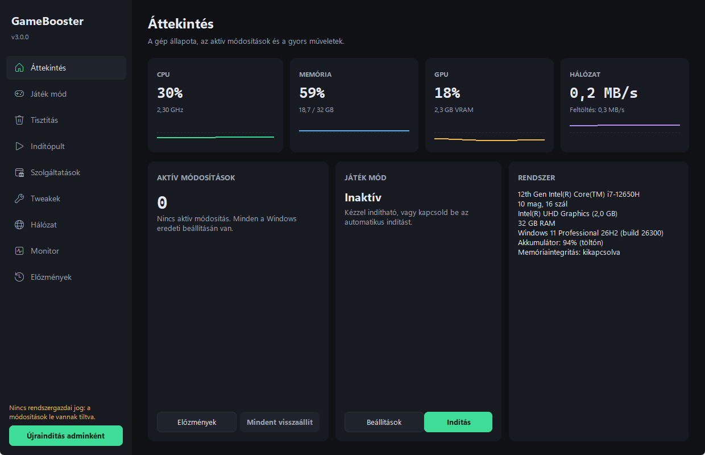
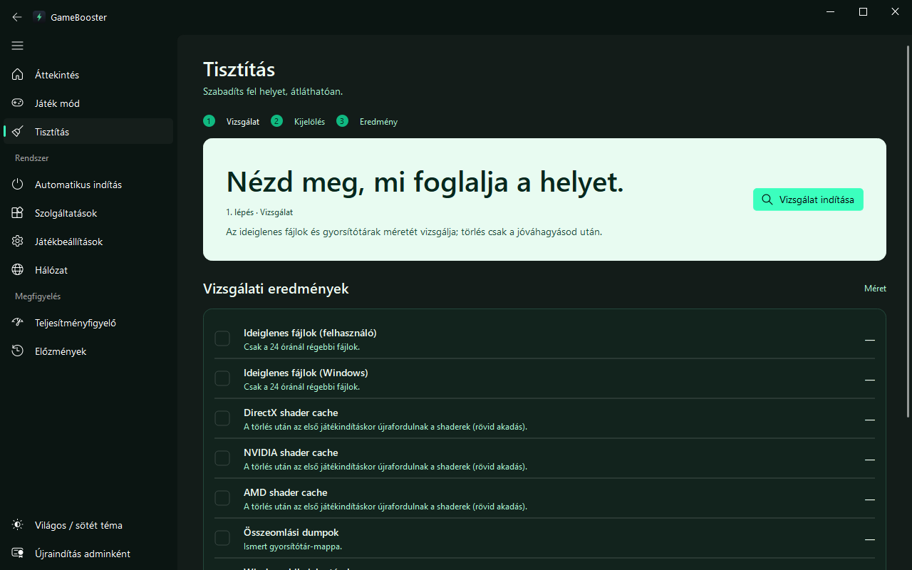
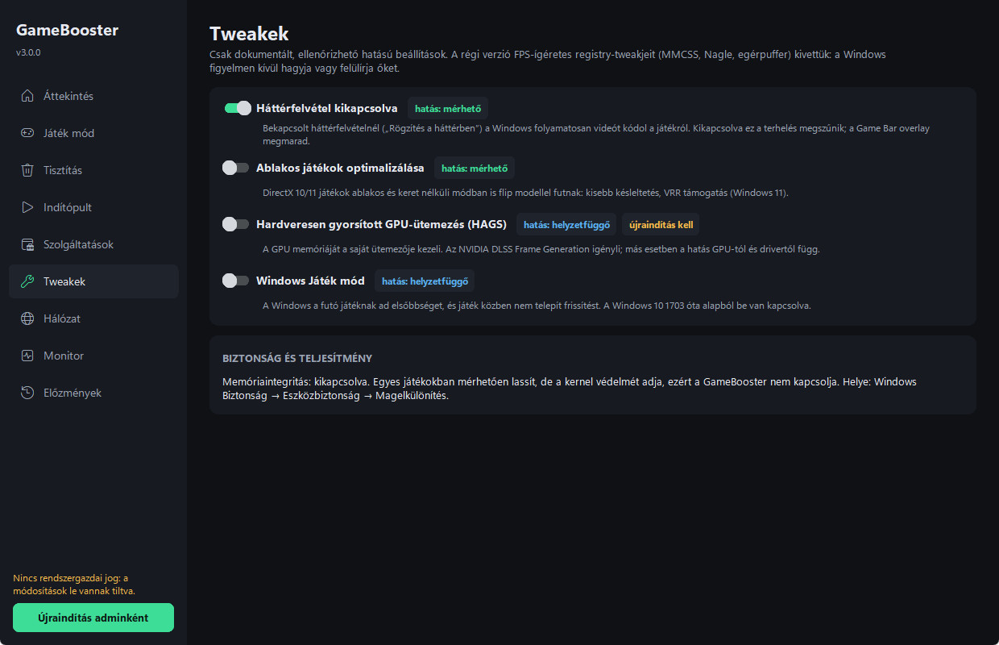
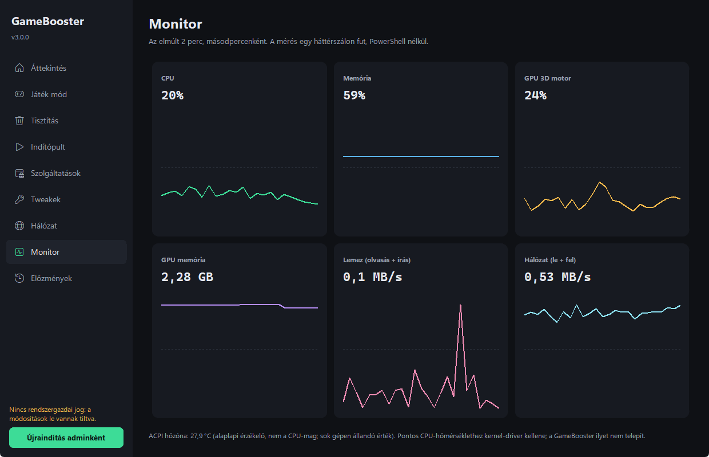

# GameBooster: Windows game optimizer you can undo


A desktop app that applies only documented, checkable Windows optimizations, shows you the exact
change list before it touches anything, and records every original value in a change journal so
you can revert one change or all of them later.



## What it does

| Page | What it changes | How it is undone |
|---|---|---|
| **Game mode** | Performance power plan (Ultimate/High, or the Windows 11 "Best performance" power mode on Modern Standby laptops), HIGH priority for the game, BELOW_NORMAL for background apps you pick | Automatically when the game exits, when you stop the session, or when the app closes |
| **Cleaner** | Deletes temp files older than 24 h, DirectX/NVIDIA/AMD shader caches, crash dumps, error reports, Delivery Optimization cache, component store cleanup (DISM) | Not revertable, so it scans first and shows sizes; never follows junctions, never touches documents or the Recycle Bin |
| **Startup** | Turns startup apps on/off through `StartupApproved`, the same mechanism Task Manager uses | Journal, or toggle back |
| **Services** | A fixed, risk-labelled allowlist (telemetry, Maps, Fax, SysMain, Search…) set to Manual instead of Disabled | Journal restores the original start type, including delayed start, and restarts services that were running |
| **Tweaks** | Background recording off, windowed-game optimizations, HAGS, Windows Game Mode | Journal |
| **Network** | DNS presets per adapter, DNS cache flush, TCP latency/jitter test | Journal |
| **Monitor** | Nothing: CPU, RAM, GPU, VRAM, disk and network history from in-process PDH counters | — |

Before the first change of a session the app asks Windows for a System Restore point as an extra,
independent safety net.

### What it deliberately does not do

Version 2 shipped several tweaks that Windows ignores or overrides, or that hurt more than they
help. Version 3 removed them:

- **"RAM cleaning"** (`EmptyWorkingSet` on every process): Windows pages the memory straight back
  in, which causes stutter.
- **MMCSS `GPU Priority`, `SFIO Priority`**: Microsoft documents both as unused.
- **`SystemResponsiveness = 0`**: values below 10 are reset to 20 by Windows.
- **Nagle / `TCPNoDelay`, `MouseDataQueueSize`, `Win32PrioritySeparation`**: no measurable effect
  for modern games.
- **Disabling Windows Update or biometrics.**

CPU core temperature needs a kernel driver (the WinRing0 driver used by many tools is flagged by
Microsoft Defender). GameBooster installs no driver: it shows the ACPI thermal zone, and the GPU
temperature on NVIDIA if `nvidia-ml-py` is installed.

## Install

Download **`GameBooster-Setup-x.y.z.exe`** from the
[latest release](https://github.com/AdamDruszad/pc-optimizer/releases/latest) and run it. The installer
puts the app in `Program Files`, adds it to the Start menu (type "GameBooster" in Start to launch it),
optionally adds it to `PATH` (then `gamebooster` works in any terminal) and registers an uninstaller
in **Settings → Apps**. No Python needed. A portable zip is attached to the release too.

The exe is not code-signed yet (see the [code signing policy](CODE_SIGNING_POLICY.md)), so on first
launch Windows SmartScreen may show "Windows protected your PC": click **More info → Run anyway**.
If Smart App Control is turned on, Windows blocks unsigned apps without that option; signed builds
will fix this.

Data (journal, settings, log) lives in `%LOCALAPPDATA%\GameBooster`. Uninstalling keeps it, so
changes stay revertable after a reinstall; revert them in **History** before uninstalling if you
want a clean system.

### Run from source

```bash
pip install -r requirements.txt
python main.py
```

Modifying features need Administrator rights; without them the app runs read-only and offers a
"restart as admin" button.

Upgrading from 2.x: on first start, v3 imports the old `original_state.json` and
`registry_snapshot.json` into the journal, so changes made by v2 can be reverted from **History**.

## Build

```cmd
build.bat           :: venv + dependencies + PyInstaller -> dist\GameBooster\GameBooster.exe
                    :: + dist\GameBooster-Setup-x.y.z.exe if Inno Setup 6 is installed
```

Releasing: bump `__version__` in `gamebooster/__init__.py`, then push a matching tag (`v3.0.1`).
The `release` workflow runs the tests, builds the exe and the installer, and publishes both on the
Releases page.

Details: [BUILD_GUIDE.md](BUILD_GUIDE.md)

## Development

```bash
pip install -e ".[dev]"
pytest
ruff check gamebooster tests main.py
```

Tests never touch the real system: Windows calls are replaced with fakes. Don't run apply paths on
your development machine to "try" them; use Windows Sandbox or a VM.

```
gamebooster/
├── core/          journal (change records + revert), winapi, storage, restore point, v2 import
├── optimizers/    each module only *plans* changes: power, tweaks, services, game_mode,
│                  cleaner, startup, network
├── monitoring/    sampler thread (psutil + PDH), hardware info from the registry
└── ui/            CustomTkinter shell, design tokens, task runner, pages/
```

## Screenshots

| Cleaner | Tweaks | Monitor |
|---|---|---|
|  |  |  |

## Code signing policy

Signed releases will use free code signing provided by [SignPath.io](https://about.signpath.io/),
certificate by [SignPath Foundation](https://signpath.org/). Team roles, what gets signed and the
privacy statement: [CODE_SIGNING_POLICY.md](CODE_SIGNING_POLICY.md).

## License

MIT. Made by [AdamDruszad](https://github.com/AdamDruszad).
